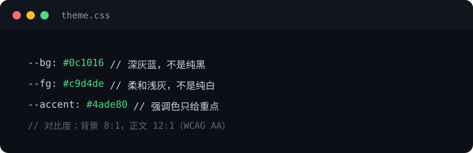

一个黑底绿字的窗口，几十年过去了，依然没有被任何 GUI 取代。这不是怀旧，而是它确实做对了什么。

## 等宽字体的秩序感

等宽字体让每个字符占据相同的宽度，于是文本天然对齐：

```
$ ls -la
drwxr-xr-x  5 user staff   160  docs/
-rw-r--r--  1 user staff  2048  notes.md
```

这种对齐不靠任何布局引擎，是字符网格自带的秩序。界面对齐了，心也就静了。

## 提示符：最小化的身份感

`you@host:~$` 这一行小字包含了用户、位置和状态，却只占十几个字符。好的界面设计也是如此——**信息密度高，视觉噪音低**。

| 界面元素 | 图形界面惯用 | 终端的做法 |
|----------|--------------|------------|
| 层级 | 阴影、卡片、圆角 | 缩进、分隔线 |
| 强调 | 大色块、图标 | 颜色、粗细 |
| 反馈 | 弹窗、动画 | 文本输出 |

## 深色不是炫酷，是专注

深色背景降低环境光刺激，让前景内容成为唯一的光源。但深色模式最容易做错的一点是对比度：纯黑背景配纯白文字会刺眼，正确的做法是

- 背景用深灰蓝（如 `#0c1016`）而非纯黑
- 正文用柔和的浅灰而非纯白
- 强调色只给真正重要的东西



图片就放在文章自己的文件夹里（`images/`），用相对路径引用——Astro 构建时会自动处理。

## 结语

终端美学的本质是克制：没有多余的装饰，每个像素都有存在的理由。把这种克制搬到 Web 上，就是所谓的"终端风"——它不是复古皮肤，而是一种设计纪律。
